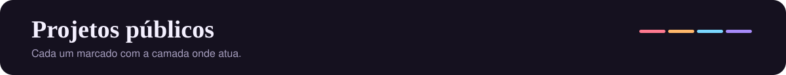
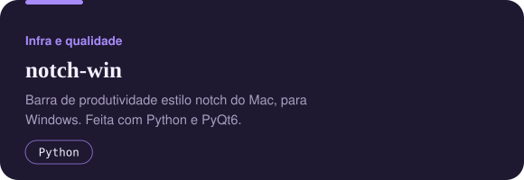
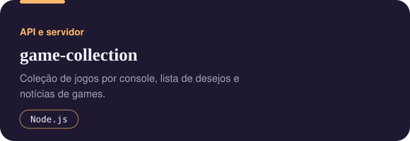
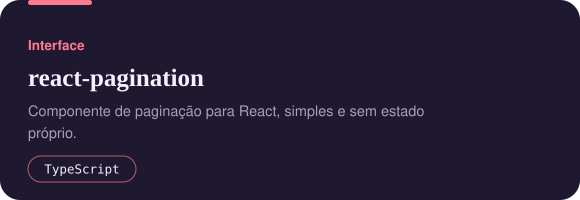
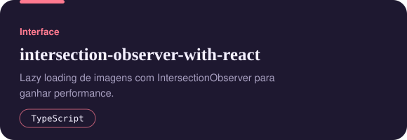
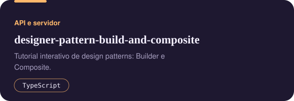
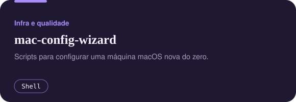

 

  

  
  
  
  
  
  

Boa parte do que construo hoje, como plataformas full stack e orquestração de agentes de IA, está em repositórios privados.

  

<picture>
  <source media="(prefers-color-scheme: dark)" srcset="https://raw.githubusercontent.com/m4rcosazevedo/m4rcosazevedo/output/github-contribution-grid-snake-dark.svg">
  
</picture>

  

 

