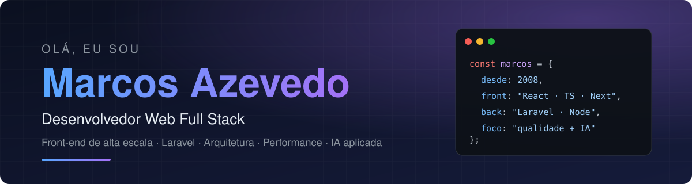

 

---

## 👨‍💻 Sobre mim

Desenvolvedor Web desde **2008**, com foco em **projetos de grande porte**. Domino programação funcional e orientada a objetos, e tenho profundidade em **JavaScript/TypeScript** e **PHP (Laravel)**.

- 🎯 **Front-end é a minha especialidade:** React, Next.js, TypeScript, HTML e CSS, com arquitetura modular, performance e acessibilidade.
- 🧱 **Back-end e dados:** Laravel e Node.js, com MySQL, PostgreSQL, SQL Server e Redis.
- 🚢 **DevOps no dia a dia:** Docker, AWS e Git para encurtar o ciclo entre ideia e produção.
- 🤖 **Hoje exploro IA aplicada ao desenvolvimento:** agentes, automação e geração de mídia local.
- 🌱 Autodidata por natureza: sempre estudando, testando e compartilhando o que aprendo.

---

## 🛠️ Stack

| | |
|:--|:--|
| **Front-end** |         |
| **UI & Estilo** |         |
| **Back-end & Dados** |        |
| **Qualidade, DevOps & Ferramentas** |           |

---

## 🚀 Projetos em destaque

| Projeto | Descrição | Stack |
|:--|:--|:--|
| [**notch-win**](https://github.com/m4rcosazevedo/notch-win) | Barra de produtividade estilo "notch" do Mac, para Windows. |   |
| [**game-collection**](https://github.com/m4rcosazevedo/game-collection) | Coleção de jogos por console, lista de desejos e notícias de games. |   |
| [**react-pagination**](https://github.com/m4rcosazevedo/react-pagination) | Componente de paginação para React, simples e sem estado próprio. |   |
| [**intersection-observer-with-react**](https://github.com/m4rcosazevedo/intersection-observer-with-react) | Lazy loading de imagens com `IntersectionObserver` para ganhar performance. |   |
| [**designer-pattern-build-and-composite**](https://github.com/m4rcosazevedo/designer-pattern-build-and-composite) | Tutorial interativo de design patterns (Builder e Composite). |  |
| [**jokenpo**](https://github.com/m4rcosazevedo/jokenpo) | Pedra, papel e tesoura em React + TypeScript, feito para ensino. |   |
| [**mac-config-wizard**](https://github.com/m4rcosazevedo/mac-config-wizard) | Scripts para configurar uma máquina macOS nova do zero. |  |

> 🔒 Boa parte do que construo hoje (plataformas full stack, orquestração de agentes de IA e ferramentas internas) está em repositórios privados.

---

## 📊 Atividade no GitHub

  

<picture>
  <source media="(prefers-color-scheme: dark)" srcset="https://raw.githubusercontent.com/m4rcosazevedo/m4rcosazevedo/output/github-contribution-grid-snake-dark.svg">
  
</picture>

---

## 🌐 O que eu entrego

| | |
|:--|:--|
| 🏗️ **Arquitetura escalável** | Front-ends modulares, fáceis de evoluir e de manter. |
| ⚡ **Performance** | Código otimizado para carregar rápido e responder fluido. |
| 🔐 **Segurança** | Práticas robustas contra vulnerabilidades conhecidas. |
| ♿ **Acessibilidade** | Interfaces utilizáveis por todos, seguindo as diretrizes WCAG. |
| 🤝 **Colaboração** | Trabalho próximo de design, back-end e negócio para alinhar resultado e meta. |
| 🔄 **Evolução contínua** | Atualização constante em tendências e tecnologias. |

---

### 📫 Vamos conversar?

Aberto a novas oportunidades, parcerias e boas discussões técnicas.

